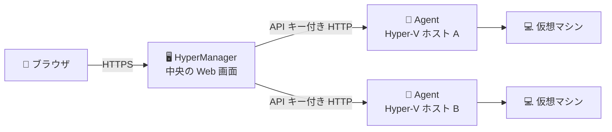

# 🖥️ HyperManager

**複数の Hyper-V ホストにある仮想マシンを、ブラウザの 1 画面でまとめて監視・操作できるツールです。**

ホストごとに Hyper-V マネージャーを開かなくても、すべての仮想マシンの状態確認と、開始・停止などの操作ができます。

---

## ✨ できること

| | 機能 | 内容 |
|---|---|---|
| 👀 | まとめて見る | 全ホストの仮想マシンを 1 つの表に表示します。状態・CPU・メモリ・稼働時間がひと目で分かります |
| 📊 | ホストの負荷を見る | ホストごとに CPU・メモリ・ディスクの使用率をゲージで表示します |
| 🎛️ | 操作する | 開始・再開・一時停止・状態保存・シャットダウン・強制停止。実行前に確認ダイアログが出ます |
| 🔄 | いつも最新 | 10 秒ごとに自動で更新します。開いている全員の画面に同じ情報が届きます |
| 📜 | 履歴が残る | 「いつ・誰が・どの仮想マシンに・何をしたか」を記録します。検索や CSV 出力もできます |
| 🔐 | ログインで守る | ログインした人だけが使えます。仮想マシンの操作は管理者だけが行えます |

---

## 🧩 しくみ

HyperManager は 2 つのソフトウェアでできています。



| | ソフトウェア | 入れる場所 | 役割 |
|---|---|---|---|
| 🖥️ | **HyperManager**（`HyperManager.Host`） | 管理用のサーバー 1 台 | 画面・ログイン・操作履歴 |
| 🤖 | **Agent**（`HyperManager.Agent`） | 監視したい **Hyper-V ホストすべて** | Hyper-V から情報を集め、操作を実行する |

> 💡 ブラウザがアクセスするのは HyperManager だけです。Agent は HyperManager からだけ呼び出されます。

---

## 📋 動作環境

| | 🖥️ HyperManager | 🤖 Agent |
|---|---|---|
| OS | Windows または Linux | Windows 10 / 11（Pro 以上）、Windows Server（**Hyper-V が有効**） |
| ランタイム | ASP.NET Core 10 ランタイム | ASP.NET Core 10 ランタイム |
| 権限 | 一般ユーザーで動作 | **管理者権限**（Windows サービスとして動かせば満たせます） |
| ポート（例） | 8443（HTTPS）または 8080（HTTP） | 5100 |
| ブラウザ | Edge / Chrome / Firefox の最新版 | — |

---

## 🚀 導入手順

> 📁 ここではすべて `C:\HyperManager` の下に置く例で説明します。

### 1️⃣ 配布ファイルを作る

ソースコードのフォルダで実行します（.NET 10 SDK が必要です）。

```powershell
dotnet publish src/HyperManager.Agent -c Release -o publish\Agent
dotnet publish src/HyperManager.Host -c Release -o publish\Host
```

> 💡 `-r win-x64 --self-contained` を付けると、配布先にランタイムを入れなくても動きます。

### 2️⃣ Agent を入れる（Hyper-V ホストごとに）

**🔑 API キーを作る** — HyperManager が Agent を呼び出すときの合言葉です。ホストごとに別の値にしてください。

```powershell
$b = New-Object byte[] 32; [Security.Cryptography.RandomNumberGenerator]::Create().GetBytes($b); ($b | ForEach-Object { $_.ToString('x2') }) -join ''
```

**📂 ファイルを置く** — `publish\Agent` を `C:\HyperManager\Agent` にコピーし、同じフォルダに `appsettings.Production.json` を作ります。

```json
{
  "Agent": {
    "ApiKey": "<作った API キー>"
  }
}
```

> ⚠️ API キーを設定しないと Agent は起動しません。

**⚙️ Windows サービスとして登録する**（管理者の PowerShell）

```powershell
New-Service -Name HyperManagerAgent -DisplayName "HyperManager Agent" -BinaryPathName "C:\HyperManager\Agent\HyperManager.Agent.exe" -StartupType Automatic
Start-Service HyperManagerAgent
```

**🧱 ファイアウォールを開ける** — 5100 番ポートを、HyperManager のサーバーからだけ許可します。

```powershell
New-NetFirewallRule -DisplayName "HyperManager Agent" -Direction Inbound -Protocol TCP -LocalPort 5100 -RemoteAddress <HyperManager サーバーの IP> -Action Allow
```

**✅ 動作を確かめる**

```powershell
curl.exe http://localhost:5100/health
curl.exe -H "X-Api-Key: <作った API キー>" http://localhost:5100/api/host
```

`Healthy` と `{"name":"<ホスト名>","isElevated":true}` が返れば準備完了です。

### 3️⃣ HyperManager を入れる（管理用サーバーに）

**📂 ファイルを置く** — `publish\Host` を `C:\HyperManager\Host` にコピーし、同じフォルダに `appsettings.Production.json` を作ります。

```json
{
  "Auth": {
    "InitialAccount": { "Id": "admin", "Password": "<最初の管理者パスワード>" }
  },
  "Agent": {
    "Hosts": [
      { "Name": "Host A", "Url": "http://192.168.1.10:5100", "ApiKey": "<Host A の API キー>" },
      { "Name": "Host B", "Url": "http://192.168.1.11:5100", "ApiKey": "<Host B の API キー>" }
    ]
  }
}
```

| 項目 | 説明 |
|---|---|
| `Auth:InitialAccount` | 最初のログインアカウント（管理者）。**初回起動時に 1 度だけ**作られます |
| `Agent:Hosts` | 監視するホストの一覧。`Name` は画面での表示名、`Url` は Agent のアドレス、`ApiKey` は手順 2️⃣ のキー |

**🔒 通信の方法を選ぶ** — 本番では、ログイン情報を守るため**既定で HTTPS が必要**です（[🔒 HTTPS と HTTP](#-https-と-http)）。どちらかを選んで `appsettings.Production.json` に追加します。

| | 方法 | こんなとき | 開く URL |
|---|---|---|---|
| 🅰️ | **HTTPS**（おすすめ） | 通常はこちら | `https://<サーバー名>:8443/` |
| 🅱️ | **HTTP** | 信頼できるネットワーク内で、証明書を用意せずに使いたい | `http://<サーバー名>:8080/` |

<details>
<summary>🅰️ HTTPS にする</summary>

社内 CA の証明書（PFX）があればそれを使ってください。ない場合は自己署名証明書を作れます（管理者の PowerShell）。

```powershell
New-Item -ItemType Directory -Force C:\HyperManager\cert
$cert = New-SelfSignedCertificate -DnsName "hypermanager.example.local" -CertStoreLocation Cert:\LocalMachine\My -NotAfter (Get-Date).AddYears(5)
Export-PfxCertificate -Cert $cert -FilePath C:\HyperManager\cert\hypermanager.pfx -Password (Read-Host -AsSecureString "PFX のパスワード")
```

> ⚠️ 自己署名証明書ではブラウザに警告が出ます。利用する PC で証明書を信頼済みにしてください。

`appsettings.Production.json` に `Kestrel` を追加します。

```json
"Kestrel": {
  "Endpoints": {
    "Https": {
      "Url": "https://*:8443",
      "Certificate": { "Path": "C:\\HyperManager\\cert\\hypermanager.pfx", "Password": "<PFX のパスワード>" }
    }
  }
}
```

</details>

<details>
<summary>🅱️ HTTP で使う</summary>

`appsettings.Production.json` の `Auth` に `"AllowHttp": true` を追加します。HTTP の 8080 番で待ち受けます。

```json
"Auth": {
  "AllowHttp": true,
  "InitialAccount": { "Id": "admin", "Password": "<最初の管理者パスワード>" }
}
```

> ⚠️ パスワードやログイン状態が暗号化されずに流れます。信頼できるネットワーク内だけで使ってください。

</details>

**⚙️ Windows サービスとして登録する**（管理者の PowerShell。ファイアウォールのポートは 🅰️ なら 8443、🅱️ なら 8080）

```powershell
New-Service -Name HyperManager -DisplayName "HyperManager" -BinaryPathName "C:\HyperManager\Host\HyperManager.Host.exe" -StartupType Automatic
Start-Service HyperManager
New-NetFirewallRule -DisplayName "HyperManager" -Direction Inbound -Protocol TCP -LocalPort 8443 -Action Allow
```

### 4️⃣ ブラウザで開く 🎉

🅰️ なら `https://<サーバー名>:8443/`、🅱️ なら `http://<サーバー名>:8080/` を開き、手順 3️⃣ で決めたアカウントでログインします。

> 💡 設定は `appsettings.Production.json` に書いてください。新しい版の配布ファイルをコピーしても、このファイルは上書きされません。

---

## 🖱️ 使い方

### 🔑 ログイン

ID とパスワードを入力して［ログイン］を押します。右上にユーザー名とログアウトボタンが表示されます。
左上の ☰ でメニューの開閉、メニューから「仮想マシン」と「操作履歴」を切り替えます。

### 🖥️ 仮想マシン画面

トップページです。上から順に次の 3 つが並びます。

1. **ヘッダー** — 「最終更新」の時刻と［🔄 更新］ボタン
2. **ホストカード** — ホストごとの状態
3. **仮想マシンの一覧** — 全ホストの仮想マシン

#### 🗂️ ホストカード

| 表示 | 意味 |
|---|---|
| 🟢 管理者 | 正常です。仮想マシンの操作もできます |
| 🟡 非管理者 | Agent が管理者権限なしで動いています。仮想マシンが表示されません（[❓ 困ったときは](#-困ったときは)） |
| 🔴 到達不可 | Agent に接続できません。カードに理由が表示されます（[❓ 困ったときは](#-困ったときは)） |
| CPU / メモリ / ディスク | 使用率のゲージ。🔵 通常 → 🟡 75% 以上 → 🔴 90% 以上 |

#### 📋 仮想マシンの一覧

| 列 | 内容 |
|---|---|
| ホスト | ホストカードの表示名 |
| 名前 | 仮想マシンの名前 |
| 状態 | 下の「状態の見かた」を参照 |
| CPU (%)・メモリ (MB)・稼働時間 | 実行中の仮想マシンだけ表示されます |
| バージョン | 仮想マシンの構成バージョン |
| 操作 | 今の状態で実行できる操作のボタン（管理者だけに表示） |

- 🔍 「名前」欄に入力すると、名前の一部で絞り込めます
- 🏷️ ホストが 2 台以上のときは「ホスト」で絞り込めます
- ↕️ 列の見出しをクリックすると並べ替えます
- 📄 25 / 50 / 100 件ずつ表示できます

#### 🚦 状態の見かた

| 状態 | 意味 |
|---|---|
| 🟢 実行中 | 動いています |
| ⚪ 停止 | 電源が切れています |
| 🔵 保存済み | 状態を保存して止まっています（開始すると続きから動きます） |
| 🟡 一時停止 | 一時停止しています |
| ⏳ 起動中・停止中・保存中・一時停止中・再開中 | 切り替えの途中です。終わるまで操作ボタンは出ません |
| ❔ 不明 | 上記以外の状態です。操作ボタンは出ません |

### 🎛️ 仮想マシンを操作する

「操作」列のボタンを押します（マウスを乗せると操作名が表示されます）。

| | 操作 | 使える状態 | 何が起きるか |
|---|---|---|---|
| ▶️ | 開始 | 停止・保存済み | 仮想マシンを起動します |
| ⏯️ | 再開 | 一時停止 | 一時停止から元に戻します |
| ⏸️ | 一時停止 | 実行中 | 仮想マシンを一時停止します |
| 💾 | 状態保存 | 実行中 | メモリの内容を保存して止めます |
| 📴 | シャットダウン | 実行中 | ゲスト OS に正常な終了をお願いします（ゲスト側の統合サービスが必要） |
| ⛔ | 強制停止 | 実行中・一時停止 | 電源を切ります。⚠️ 保存していないデータは失われます |

操作の流れは次のとおりです。

1. 🖱️ ボタンを押すと確認ダイアログが開きます。内容を確かめて実行します（［キャンセル］で中止）
2. ⏳ 「処理中...」の間は、ほかの操作はできません
3. 🔔 結果が画面右下に通知されます。失敗したときは画面上部にも理由が表示されます
4. 🔄 一覧が最新の状態になり、📜 操作履歴に記録されます

> 🔒 操作ボタンは、管理者のユーザーにだけ表示されます。最初に作られるアカウントは管理者です。

### 📜 操作履歴

メニューの「操作履歴」で開きます。新しい順に表示されます。

| 列 | 内容 |
|---|---|
| 日時 | 操作した日時 |
| ユーザー | 操作した人 |
| ホスト・仮想マシン | 操作の対象 |
| 操作 | 開始・強制停止など |
| 結果 | ✅ 成功 / ❌ 失敗 |
| メッセージ | 失敗した理由 |

- 🔍 ホスト名か仮想マシン名の一部で検索できます（［検索］または Enter）
- 📥 ［CSV］で全件をダウンロードできます（Excel でそのまま開けます）

### 🔄 画面の更新

- ⏱️ 10 秒ごとに自動で最新になります（間隔は設定で変えられます）
- 🔄 ［更新］を押すと、すぐに最新にします
- 🎛️ 操作のあとは自動で最新になります
- 🕒 「最終更新」の時刻で、表示がいつの状態かを確認できます

---

## ⚙️ よく使う設定

設定は各フォルダの `appsettings.Production.json` に書き、サービスを再起動すると反映されます（例: `Restart-Service HyperManager`）。

| ソフトウェア | 設定 | 既定値 | 内容 |
|---|---|---|---|
| 🖥️ | `Agent:Hosts` | なし | 監視するホストの一覧（`Name`・`Url`・`ApiKey`） |
| 🖥️ | `Monitor:IntervalSeconds` | `10` | 自動更新の間隔（秒） |
| 🖥️ | `Monitor:Enable` | `true` | `false` にすると自動更新を止めます（［更新］ボタンのみ） |
| 🖥️ | `Auth:ExpireMinutes` | `1440` | ログインの有効時間（分）。使っている間は延長されます |
| 🖥️ | `Auth:AllowHttp` | `false` | `true` にすると HTTP でもログインできます（信頼できるネットワーク内だけ） |
| 🖥️ | `Agent:QueryTimeoutSeconds` | `10` | ホストの状態を取得するときの待ち時間（秒） |
| 🖥️ | `Agent:OperationTimeoutSeconds` | `330` | 操作の完了を待つ時間（秒） |
| 🤖 | `Agent:ApiKey` | なし（必須） | API キー |
| 🤖 | `http_ports` | `5100` | 待ち受けるポート |

📖 すべての設定は [⚙️ 設定リファレンス](docs/configuration.md) を参照してください。

---

## 🔒 HTTPS と HTTP

- 🔐 ログイン情報を守るため、本番では**既定でログイン状態（Cookie）を HTTPS でしか送りません**。そのまま HTTP で開くと、ログインしても画面に入れません。
- 使い方は 3 通りです。

| | 方法 | 設定 |
|---|---|---|
| 🅰️ | **HyperManager 自体で HTTPS にする**（おすすめ） | 手順 3️⃣ の 🅰️（`Kestrel` と証明書） |
| 🅱️ | **HTTP のまま使う** | 手順 3️⃣ の 🅱️（`Auth:AllowHttp` を `true`）。⚠️ パスワードも暗号化されずに流れるため、信頼できるネットワーク内だけで |
| 🔁 | **リバースプロキシ（IIS・nginx など）で HTTPS にする** | プロキシで HTTPS を受けて 8080 番へ転送（WebSocket も転送） |

- 🖥️ サーバー自身のブラウザで `http://localhost:8080/` を開く場合は、設定を変えなくても HTTP で使えます。
- 🤖 HyperManager と Agent の間は HTTP です。API キーは暗号化されずに流れるので、信頼できるネットワーク内で使ってください。

📖 詳しくは [🩺 運用ガイド](docs/operations.md#-https-と-http) を参照してください。

---

## 🛡️ 安全に使うために

- 🔑 最初の管理者パスワードは、推測されにくい値にして**初回起動の前に**設定する
- 🔒 できるだけ HTTPS で使う（HTTP を許可するのは信頼できるネットワーク内だけ）
- 🔑 API キーはホストごとに長いランダム値にする
- 🧱 Agent の 5100 番ポートは HyperManager のサーバーからだけ許可する
- 🏠 Agent との通信は、信頼できるネットワーク内に限る
- ⚠️ 強制停止は最後の手段にする（保存していないデータが失われます）

---

## ❓ 困ったときは

<details>
<summary>🔴 ホストが「到達不可」になる</summary>

- Agent のサービスが動いているか確認します: `Get-Service HyperManagerAgent`
- `Agent:Hosts` の `Url`（アドレス・ポート）が正しいか、ファイアウォールで止められていないか確認します
- HyperManager のサーバーから確認します: `curl.exe http://<ホスト>:5100/health`
- 「認証に失敗しました (API キーを確認してください)」→ HyperManager と Agent の API キーが一致していません
- 「応答がタイムアウトしました」→ ネットワークや Agent が混み合っています

</details>

<details>
<summary>🟡 「非管理者」と表示され、仮想マシンが出てこない</summary>

Agent が管理者権限なしで動いています。Hyper-V は権限のない利用者に仮想マシンを見せないため、一覧が空になります。
手順 2️⃣ のとおり Windows サービスとして登録してください（標準の LocalSystem アカウントで管理者権限を持ちます）。

</details>

<details>
<summary>❌ シャットダウンが失敗する</summary>

ゲスト OS の協力が必要な操作です。

- 仮想マシンの設定 →「統合サービス」→「オペレーティング システムのシャットダウン」が有効か確認します
- ゲスト OS が起動しきっていない、または応答していない可能性があります
- どうしても止まらないときは強制停止を使います（データが失われる可能性があります）

</details>

<details>
<summary>❌ 「現在の状態では実行できません」と表示される</summary>

ほかの人や Hyper-V マネージャーの操作で、状態がすでに変わっている可能性があります。［🔄 更新］を押してから操作し直してください。

</details>

<details>
<summary>⏳ 操作がタイムアウトした</summary>

メモリの大きい仮想マシンの状態保存などは時間がかかることがあります。Hyper-V 側では処理が続いている場合があるので、少し待ってから［🔄 更新］を押して状態を確認してください。

</details>

<details>
<summary>🔐 ログインしても画面に入れない / パスワードを忘れた</summary>

- HTTP で開いている場合は、HTTPS にするか `Auth:AllowHttp` を `true` にします（[🔒 HTTPS と HTTP](#-https-と-http)）
- 「IDまたはパスワードが違います。」→ 入力を確認してください
- パスワードを忘れたときは [🩺 運用ガイド](docs/operations.md#-パスワードを忘れたとき) の手順で作り直せます

</details>

<details>
<summary>📄 ログを見たい</summary>

`C:\HyperManager\log\` に 1 日 1 ファイルで出力されます（`HyperManager.Host_YYYYMMDD.log`・`HyperManager.Agent_YYYYMMDD.log`）。
起動しないときは、Windows のイベント ビューアー（Windows ログ → Application）も確認してください。

</details>

---

## 📚 もっと詳しく

| ドキュメント | 内容 |
|---|---|
| ⚙️ [設定リファレンス](docs/configuration.md) | すべての設定項目 |
| 🩺 [運用ガイド](docs/operations.md) | HTTPS・ログ・監視・バックアップ・更新 |
| 🔄 [hv-monitor からの移行](docs/migration.md) | 旧 hv-monitor を使っていた方へ |
| 📚 [ドキュメント一覧](docs/README.md) | 開発者向けを含むすべてのドキュメント |

---

## 📄 ライセンス

[MIT License](LICENSE)
