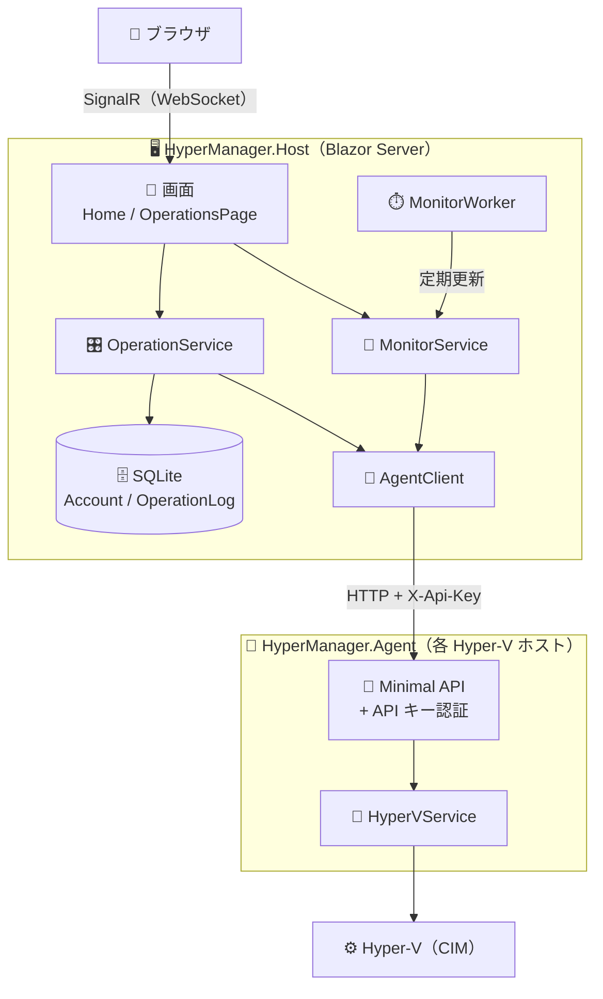
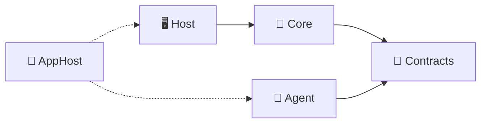
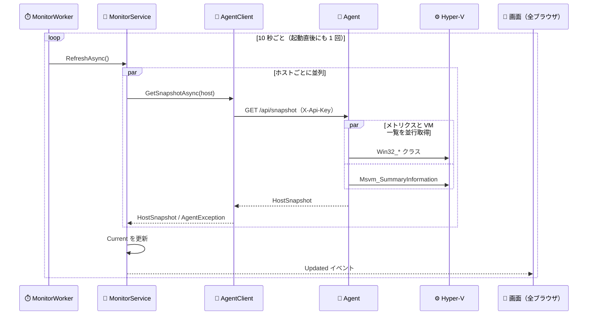
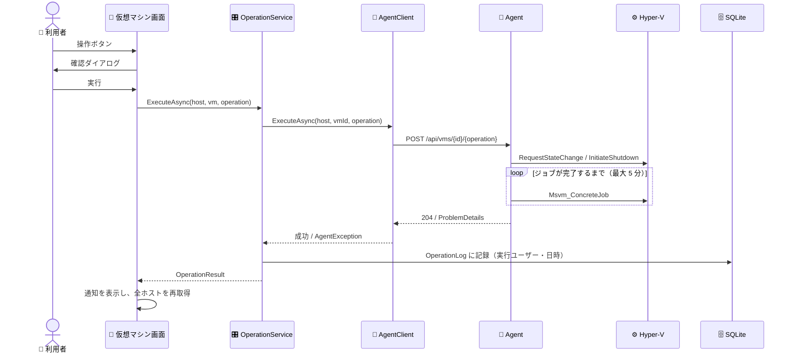

# 🏗️ アーキテクチャ

HyperManager の全体構成、処理の流れ、データ、設計方針をまとめます。

---

## 🎯 目的とスコープ

複数の Hyper-V ホストにある仮想マシンを、ブラウザから一覧・監視し、基本的な操作を行えるようにします。
利用者はホストを管理する運用者・開発者で、信頼できるネットワーク内での利用を想定しています。

| | 内容 |
|---|---|
| ✅ 対応 | 複数ホストの VM 一覧、状態・CPU・メモリ・稼働時間、ホストメトリクス（CPU・メモリ・ディスク）、開始・再開・一時停止・状態保存・シャットダウン・強制停止、自動更新、ログイン、操作履歴（検索・CSV）、ヘルスチェック、メトリクス |
| 🔜 将来 | Agent との HTTPS の標準化・mTLS、チェックポイント操作、コンソール接続、アカウント管理画面、操作履歴の保持期間、メトリクスのグラフ |
| ❌ 対象外 | VM の作成・削除、仮想ディスク・ネットワークの構成変更 |

---

## 🧩 全体構成

- 🖥️ **HyperManager** は 1 台だけ置く中央の Web アプリです。画面（Blazor Server）・ログイン・操作履歴を担当します。
- 🤖 **Agent** は Hyper-V ホストごとに置く API サーバーです。CIM で Hyper-V にアクセスします。
- 🔄 画面への更新は HyperManager が集約して配るため、ブラウザの数が増えても Agent の負荷は変わりません。

---

## 📦 プロジェクトと依存関係

| プロジェクト | TFM | 役割 |
|---|---|---|
| 📜 `HyperManager.Contracts` | net10.0 | Agent API の契約（DTO・パス・ヘッダー名）。Agent とクライアントで共有 |
| 🧠 `HyperManager.Core` | net10.0 | HyperManager 側の業務ロジック（監視・操作・履歴・アカウント・DB アクセス・Agent クライアント） |
| 🖥️ `HyperManager.Host` | net10.0 | 画面（Blazor Server / MudBlazor）、Web API、ログイン、運用機能 |
| 🤖 `HyperManager.Agent` | net10.0-windows | Hyper-V ホストの API サーバー（Windows 専用） |
| 🚀 `HyperManager.AppHost` | net10.0 | 開発用の Aspire AppHost（Agent と Host を一緒に起動） |

> 💡 HyperManager は CIM を使わないので、Windows 以外でも動きます。

---

## 🔄 処理の流れ

### 👀 監視（定期更新）

- 📸 1 ホストにつき 1 回のリクエスト（`/api/snapshot`）で、ホスト情報・メトリクス・VM 一覧をまとめて取得します。
- 🧩 ホストごとの失敗は `HostStatus.Error` として保持し、ほかのホストの表示は続けます。
- ⏱️ 取得のタイムアウトは 10 秒です。応答しないホストがあっても、更新全体が長く止まりません。
- 🔒 更新は直列に実行し、古い結果が新しい結果を上書きしないようにします。
- ⚡ 画面は開いた瞬間に `MonitorService.Current` を表示し、以降は `Updated` イベントで更新します（`InvokeAsync(StateHasChanged)`）。

### 🎛️ VM 操作

- 👤 実行ユーザーと日時は、画面のイベント境界で開始する `ServiceContext` から取ります。
- 📜 成功・失敗のどちらも操作履歴とログに残します。
- 🚦 実行できる操作は `VmOperationPolicy` が VM の状態から判定し、できない操作のボタンは表示しません。

### 🔐 認証

| 区間 | 方式 |
|---|---|
| 👤 ブラウザ → 🖥️ HyperManager | Cookie 認証（ログイン画面）。パスワードは PBKDF2（SHA256・310,000 回）でハッシュ化。VM 操作は Administrator ロールだけ。本番の Cookie は既定で `Secure`（`Auth:AllowHttp` で HTTP も許可） |
| 🖥️ HyperManager → 🤖 Agent | `X-Api-Key` ヘッダー。Agent の `AuthenticationHandler` が定数時間で比較 |

---

## 🧱 主なコンポーネント

| コンポーネント | 場所 | 役割 |
|---|---|---|
| ⏱️ `MonitorWorker` | Host / Workers | 一定間隔で `MonitorService.RefreshAsync` を呼ぶ `BackgroundService` |
| 👀 `MonitorService` | Core / Services | 全ホストの最新状態（`MonitorSnapshot`）を保持し、更新を通知する |
| 🎛️ `OperationService` | Core / Services | VM 操作の実行と操作履歴の記録・検索 |
| 📡 `AgentClient` | Core / Infrastructure / Agents | Agent API のクライアント。失敗は `AgentException` にまとめる |
| 🚦 `VmOperationPolicy` | Core / Domain | 状態ごとに実行できる操作を判定する |
| 📄 `Home` / `OperationsPage` | Host / Components / Pages | 仮想マシン画面と操作履歴画面 |
| 🗂️ `HostCard` / `VmOperationDialog` | Host / Components | ホストカードと確認ダイアログ |
| 🔑 `ApiKeyAuthenticationHandler` | Agent / Application | API キーの認証 |
| 🔌 `HostEndpoints` / `VmEndpoints` | Agent / Endpoints | Agent API |
| 🧬 `HyperVService` / `VmStateMapper` | Agent / HyperV | CIM による取得・操作と状態コードの変換（[🧬 Hyper-V 連携](hyperv.md)） |

---

## 🗄️ データ

HyperManager は SQLite（`data.db`）を使います。起動時に `Assets/Data/Schema.sql` を実行してテーブルを作ります（`CREATE TABLE IF NOT EXISTS`）。

**`Account`（ログインアカウント）**

| 列 | 型 | 内容 |
|---|---|---|
| `Id` | INTEGER | 主キー |
| `Name` | TEXT | ID（一意） |
| `Password` | BLOB | ソルト + ハッシュ |
| `Role` | TEXT | ロール（`Administrator`） |
| `CreatedAt` | TEXT | 作成日時 |

**`OperationLog`（操作履歴）**

| 列 | 型 | 内容 |
|---|---|---|
| `Id` | INTEGER | 主キー（新しい順の並びに使用） |
| `ExecutedAt` | TEXT | 実行日時（ローカル時刻） |
| `UserId` | TEXT | 実行ユーザー |
| `HostName` | TEXT | ホストの表示名 |
| `VmId` / `VmName` | TEXT | VM の ID（GUID）と名前 |
| `Operation` | TEXT | 操作（`Start` / `Resume` / `Pause` / `Save` / `Shutdown` / `TurnOff`） |
| `Success` | INTEGER | 成功なら 1 |
| `Message` | TEXT | 失敗の理由 |

> 💡 VM の状態はデータベースに保存しません（メモリ上の最新値だけを持ちます）。

---

## 🛡️ 信頼性の工夫

| 工夫 | 内容 |
|---|---|
| 🧩 部分的な失敗を許す | 1 ホストの失敗で全体を止めません。メトリクスだけ取れないときも VM 一覧は返します |
| ⏱️ タイムアウトを分ける | 取得 10 秒・操作 330 秒。Agent のジョブ待ち（300 秒）より操作のタイムアウトを長くし、Agent のエラーを受け取れるようにします |
| 🔒 更新を直列にする | 手動更新と自動更新が重なっても、古い結果で上書きしません |
| ⚡ 最新値をすぐ表示 | 画面を開いたときや再接続したときは、保持している最新値をすぐ表示します |
| ✅ 起動時に設定を検証 | 設定の誤りは起動時に検出します（API キーの未設定、ホストの URL の誤りなど） |

---

## 📝 設計方針

| ID | 論点 | 決定 | 理由 |
|---|---|---|---|
| A | Hyper-V へのアクセス | **CIM に統一** | 取得と操作を同じ仕組みで扱える |
| B | プロセス構成 | **画面と Hyper-V 操作を分ける**（Agent を各ホストに置く） | 複数ホストを 1 画面で扱え、画面側に管理者権限が要らない |
| C | 停止の方法 | **正常シャットダウンと強制停止の両方** | 強制停止は警告付きの確認ダイアログを出す |
| D | 更新方式 | **HyperManager で集約した定期取得**＋手動更新 | ブラウザの数に Agent の負荷が左右されない |
| E | 管理者権限 | **起動時に調べて画面に表示**（強制はしない） | 権限不足を利用者が気づける |
| F | 複数ホストの表示 | **1 つの表にまとめる**（ホスト列・絞り込み） | 全体を一度に見渡せる |
| G | API と認証 | **REST（Minimal API）と API キー** | シンプルで、ホストごとに鍵を分けられる |
| H | Agent との HTTPS | **組み込みでは必須にしない**（信頼できるネットワーク前提、`Kestrel` で HTTPS も可） | 導入を簡単にする |
| I | 取得の単位 | **`/api/snapshot` で 1 回にまとめる** | 往復を減らし、同じ時点の値にそろえる |
| J | アプリの土台 | **template-blazor-server の構成を採用** | ログ・計測・認証・セキュリティヘッダー・テストの仕組みを再利用する |
| K | 契約の共有 | **Contracts に DTO と API のパスを置く** | Agent とクライアントのずれを防ぐ（テストでも検出する） |
| L | 利用者の認証 | **Cookie 認証、操作は Administrator だけ** | 見るだけの利用者と操作する利用者を分けられる |
| M | 操作の監査 | **データベースに操作履歴を記録** | 画面と CSV で後から確認できる |
| N | Agent の動かし方 | **Windows サービス**（LocalSystem） | 管理者権限で常駐できる |
| O | 画面の通信 | **本番は HTTPS を既定**とし、`Auth:AllowHttp` で HTTP も許可できる | 安全を優先しつつ、信頼できるネットワークでは証明書なしでも使える |

---

## ⚠️ 既知の制約

| 項目 | 内容 |
|---|---|
| 🔓 Agent との通信 | 既定では HTTP（API キーは平文）。信頼できるネットワーク内で使う |
| 🔓 HTTP を許可した画面 | `Auth:AllowHttp` を `true` にすると、パスワードとログイン状態が平文で流れる |
| 👤 アカウント | 最初のアカウントだけ（追加・パスワード変更の画面はない） |
| 📜 操作履歴 | 自動では削除しない（[🩺 運用ガイド](operations.md#-操作履歴を整理する)） |
| 📊 CPU 使用率 | 3 段階で取得を試み、すべて失敗すると 0% と表示する |
| 🔐 権限不足 | Agent に管理者権限がないと VM が一覧に出ない（Hyper-V が返さない） |
| ⏳ 長い操作 | ジョブ待ちは既定 5 分。超えるとエラーになるが、Hyper-V 側の処理は続く場合がある |
